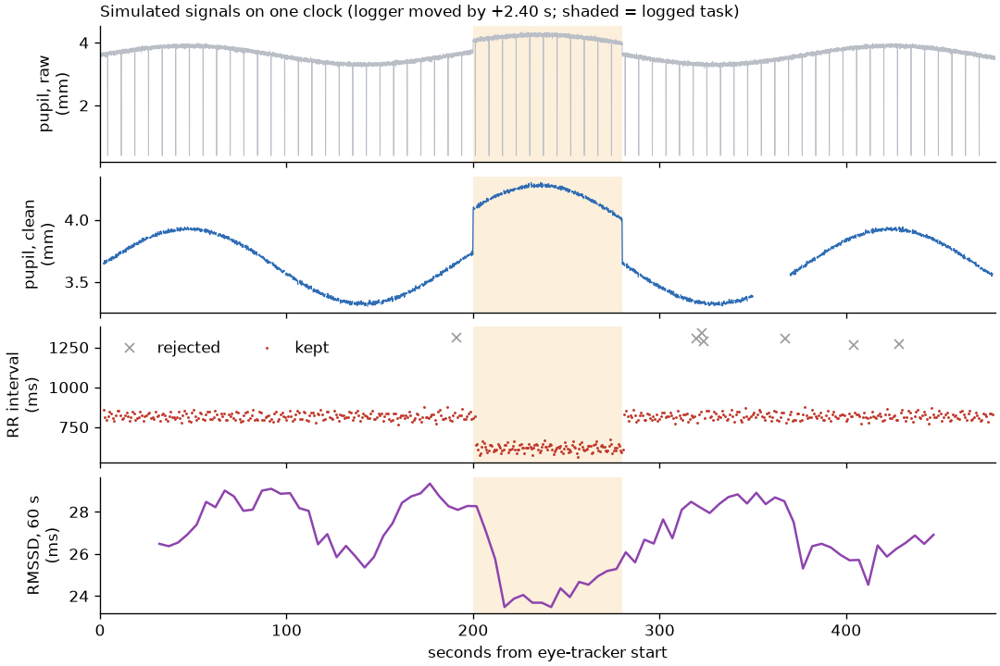
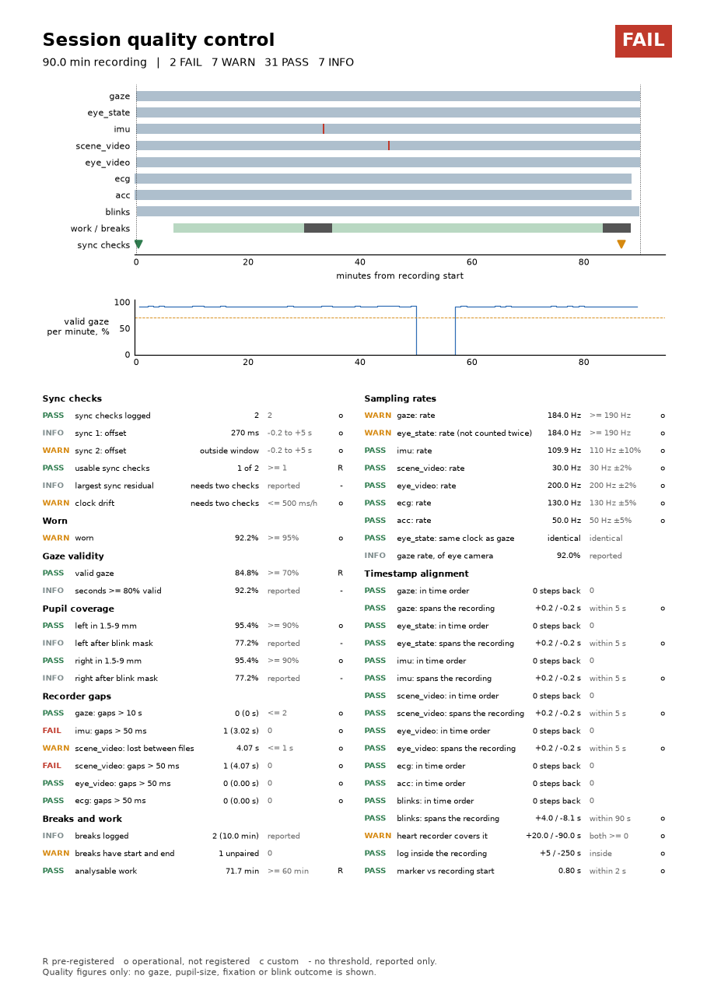

# wearable-pipeline

Puts wearable streams on one clock and preprocesses pupil and heart-rate variability, with quality control for each session.

Author: Salome Egli

- **One clock:** the eye tracker is the reference. UTC and phone-local timestamps are converted, and sync checks give each logger a constant offset.
- **Pupil:** after Kret & Sjak-Shie (2019), each eye separately: 1.5–9 mm gate, blinks plus 500 ms masked, dilation-speed filter, gap padding, short-gap interpolation, 4 Hz low pass, then the eyes combined. Every step reports what it removed.
- **HRV:** RR cleaning, RMSSD, SDNN, pNN50 and LF/HF. No difference is taken across a removed beat or a dropout.
- **Quality control:** a per-session PASS / WARN / FAIL report as JSON and one page.



## Install

Tested with Python 3.12.

```sh
python -m venv .venv && source .venv/bin/activate
pip install -r requirements.txt
```

## Quick example

```sh
python -m wearable_pipeline.demo
```

```python
from wearable_pipeline import hrv
from wearable_pipeline.demo import process, simulate

data = simulate()
result = process(data)
print(result["fit"].offset_s)
print(hrv.rmssd(data["rr"], result["keep"], result["beats"]))
```

## Quality control

`wearable_pipeline.qc` checks one session and writes a JSON report and a one-page PNG.



```sh
python -m wearable_pipeline.qc.demo           # simulated session with seven faults
python -m wearable_pipeline.qc.demo --clean   # the same without faults
```

```python
from wearable_pipeline import qc
from wearable_pipeline.qc.demo import simulate

report = qc.run_qc(simulate())
qc.write_report(report, "out/qc")  # qc_report.json, qc_summary.png
```

For your own data, fill a [`qc.Session`](wearable_pipeline/qc/session.py) with arrays. Times are seconds from the start of the eye-tracker recording. The module opens no recordings and does not find sync flashes in video: give it the detected times.

### What is checked

| Section | Checks |
|---|---|
| Sync | checks logged, offset of each, residual about their median, drift end to end |
| Worn | share of samples worn |
| Gaze | valid share of the samples expected, and of seconds |
| Pupil | share in range per eye, and what is left after blinks + 500 ms and time not worn |
| Recorder gaps | short gaps, long gaps in gaze, time lost between recorder files |
| Breaks | logged breaks, unpaired ones, analysable work after removing them |
| Sampling rates | each module against nominal, shared clocks, gaze against the eye camera |
| Alignment | time order, each stream's span, heart-recorder coverage, the log inside the recording, marker |

The verdict is the worst graded check. INFO means reported and not graded. No pupil size, gaze position, fixation or blink measure is reported, so a report can be read during data collection.

### Thresholds

Every check in the report says where its threshold comes from.

**Pre-registered** for the lab's field study:

| Key | Default | Rule |
|---|---|---|
| `gaze_valid_min_pct` | 70 | session valid gaze below this: WARN, a sensitivity restriction and not an exclusion |
| `gaze_second_valid_min_pct` | 80 | a second counts as valid gaze at or above this share |
| `analysable_min_minutes` | 60 | less analysable natural work: FAIL, a session exclusion |
| `sync_min_usable` | 1 | fewer usable sync checks: FAIL, the session is excluded if sync cannot be recovered by hand |
| `pupil_range_mm` | 1.5 to 9 | samples outside are missing |
| `post_blink_ms` | 500 | masked after every blink |

The registration does not define the denominator of session-level valid gaze. Here it is the samples expected over the recording at the median interval, so dropped samples and gaps count as invalid.

**Operational.** Working QC decisions from that study. They are **not registered**:

| Key | Default | Rule |
|---|---|---|
| `worn_pct` | pass 95, warn 80 | share of samples worn |
| `pupil_in_range_pct` | pass 90, warn 75 | per eye, before masking |
| `gap_ms` | 50 | a longer interval is a gap |
| `gap_total_fail_s` | 1 | no gap: PASS; less in total: WARN; otherwise FAIL |
| `long_gap_s` | 10 | a long gap in gaze |
| `long_gaps_pass_max` | 2 | more long gaps: WARN |
| `span_s` | pass 5, warn 15 | a stream may start late or end early by this much |
| `span_event_warn_s` | 90 | event streams may be quiet this long at either edge |
| `part_boundary_s` | pass 1, warn 30 | time lost where a recorder started a new file |
| `heart_tail_note_s` | 120 | heart recorder stopped up to this much early: WARN; more, or a late start: FAIL |
| `log_tail_note_s` | 120 | log ends up to this much after the recording: WARN; more: FAIL |
| `marker_s` | 2 | marker further from the recording start: WARN, never FAIL |
| `sync_expected` | 2 | a different number of logged sync checks: FAIL |
| `sync_window_s` | -0.2 to 5 | where a sync flash may be, relative to the logged tap |
| `sync_drift_max_ms_per_hour` | 500 | more drift, or a baseline too short to tell: WARN |
| `streams` | table below | rate: absolute floors in Hz, or relative deviation from nominal |

| Stream | Nominal | PASS | WARN, otherwise FAIL |
|---|---|---|---|
| `gaze` | 200 Hz | ≥ 190 Hz | ≥ 150 Hz |
| `eye_state` | 200 Hz | ≥ 190 Hz | ≥ 150 Hz |
| `imu` | 110 Hz | ±10% | ±20% |
| `scene_video` | 30 Hz | ±2% | ±5% |
| `eye_video` | 200 Hz | ±2% | ±5% |
| `ecg` | 130 Hz | ±5% | ±15% |
| `acc` | 50 Hz | ±5% | ±15% |

**Not set.** Neither registered nor decided, so reported only:

| Key | Default | Rule |
|---|---|---|
| `sync_residual_ms` | not set | reported; set {pass, warn} in ms to grade it |
| `pupil_after_mask_pct` | not set | reported; set {pass, warn} in % to grade it |
| `gaze_seconds_valid_pct` | not set | reported; set {pass, warn} in % to grade it |

To change any of them, pass a dict or a JSON file. Changed values are marked `custom`.

```python
report = qc.run_qc(session, {"worn_pct": {"pass": 90, "warn": 75}, "streams": {"acc": None}})
```

### Limits

- One recording at a time: a recording stopped and restarted needs one report for each.
- A drift indistinguishable from zero passes only if the baseline is long enough to have seen 500 ms/h.
- Logger times are compared as logged. The sync offset is reported and not applied, as it also holds the delay between tap and screen.
- A pass says the recorders worked, not that the measures are valid.

## Limits

No clock drift is fitted and one UTC offset is assumed per recording. Pupil size is not corrected for luminance, and the published method's isolated-island filter is not implemented. The 20% RR rule re-seeds after five agreeing beats. Pass `reseed_after=None` for the strict rule, which discards everything after a true step in heart rate. This is research code and not a medical device.

## Part of the toolkit

Five tools for field studies with wearable sensors:

[field-logger](https://github.com/cambridge-cognitive-architecture/field-logger) → **wearable-pipeline** → [spatial-twin](https://github.com/cambridge-cognitive-architecture/spatial-twin) → field-workbench (in preparation) → [egoanon](https://github.com/cambridge-cognitive-architecture/egoanon)

<!-- Overview diagram goes here: docs/toolkit.png -->

| Tool | What it does |
|---|---|
| [field-logger](https://github.com/cambridge-cognitive-architecture/field-logger) | tablet app: location by threshold crossings, tasks, interruptions and ratings, on one clock |
| **wearable-pipeline** (this repository) | eye tracking, ECG and the field log on one clock; pupil and HRV preprocessing; quality control |
| [spatial-twin](https://github.com/cambridge-cognitive-architecture/spatial-twin) | LiDAR scans against the floor plan: registration, isovists, walkable space, objects |
| field-workbench (in preparation) | one local app from project set-up through coding and compute to the master table |
| [egoanon](https://github.com/cambridge-cognitive-architecture/egoanon) | anonymisation of the head-mounted scene video |

## Licence and credit

Pupil method: Kret, M. E., & Sjak-Shie, E. E. (2019). Preprocessing pupil size data: Guidelines and code. *Behavior Research Methods, 51*, 1336–1342.

GPL-3.0-only, see [LICENSE](LICENSE) and [NOTICE](NOTICE). The pupil module was developed with reference to [the authors' GPL-3.0 MATLAB code](https://github.com/ElioS-S/pupil-size). Developed by the Cambridge Cognitive Architecture Lab.
